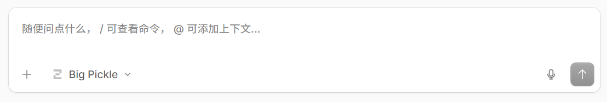
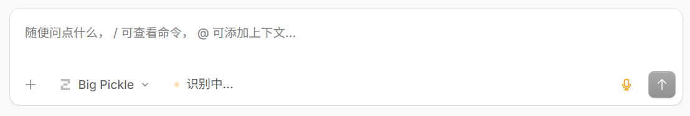

# OpenCode 语音输入插件(离线版)

为 [OpenCode Desktop](https://opencode.ai) 添加**离线语音输入**能力:按下快捷键说出你想说的话,语音在本机识别成文字,自动填入对话框。全部离线运行,不联网、不上传任何语音数据。

> 非官方社区补丁,仅供个人使用。安装包会自动备份原始文件,支持一键卸载还原。

## 功能特性

- **离线识别**:基于 sherpa-onnx + 内置中文语音识别模型,音频不出本机
- **一键说话**:默认快捷键 `Ctrl + Alt + Space`,再按一次结束并转写;识别结果自动插入当前输入框
- **智能结束**:说完静音约 1.6 秒自动结束录音并开始转写
- **内嵌状态提示**:录音时输入框旁显示"正在聆听 / 识别中…"胶囊,与界面主题融为一体,无悬浮窗打扰
- **自动修复**:OpenCode 自动更新后会后台自动重新打补丁,不用重装
- **一键卸载**:随时还原为原始版 OpenCode

## 效果展示

| 待机 | 正在聆听 | 识别中… |
| :---: | :---: | :---: |
|  |  |  |

按 `Ctrl + Alt + Space` 开始说话,说完静音约 1.6 秒自动结束,识别结果直接填入输入框;也可以随时点击输入框右侧的麦克风按钮开始/结束。

## 下载

到本仓库的 [Releases](../../releases) 页面下载对应系统的压缩包:

| 系统 | 安装包 | 大小 | 支持范围 |
| --- | --- | --- | --- |
| Windows 10/11 | `oc-voice-windows-x64.zip` | 约 180 MB | x64 |
| macOS | `oc-voice-macos-universal.zip` | 约 199 MB | Intel / Apple Silicon 通用 |
| Linux | `oc-voice-linux-x64.zip` | 约 184 MB | x64(glibc,不支持 AppImage) |

适用版本:OpenCode Desktop **v1.19.x**(其他版本可能也能用,未逐一验证)。

## 安装

> 安装前请先退出 OpenCode。安装器会自动探测 OpenCode 安装目录,无需手动选择文件夹。

**Windows**:解压后双击 `安装.bat`(如弹 UAC 请允许)。

**macOS**:解压后双击 `安装.command`。首次打开若被系统拦截,请右键 → 打开,或终端执行 `bash 安装.command`。

**Linux**:解压后执行 `bash install-linux.sh`(会提示输入 sudo 密码以提权)。

安装器会自动完成:

1. 找到 OpenCode 的安装目录
2. 把语音组件(引擎 + 模型)复制到用户数据目录
3. 给 OpenCode 打上语音补丁(自动备份原始文件)
4. 注册后台修复任务(OpenCode 更新后自动恢复补丁)

安装完成后重新打开 OpenCode,按 `Ctrl + Alt + Space` 开始说话。

## 卸载

- Windows:双击 `卸载.bat`
- macOS:双击 `卸载.command`
- Linux:执行 `bash uninstall-linux.sh`

卸载会恢复原始文件并移除后台任务。语音组件数据可一并删除。

## 常见问题

**按快捷键没反应?**
确认安装完成(安装器最后会显示成功信息),然后完全退出并重新打开 OpenCode。再不行请看 OpenCode 安装目录 `resources` 下是否存在 `app.asar.bak-voice`(存在说明补丁已装)。

**macOS 提示"无法验证开发者"?**
本插件使用 ad-hoc 签名。右键 → 打开,或终端执行 `bash 安装.command`。

**OpenCode 更新后语音失灵?**
后台修复任务每 10 分钟检查一次,更新后会自动重新打补丁,稍等片刻重启 OpenCode 即可。也可以手动重跑一次安装器(重复安装是安全的)。

**杀毒软件报警?**
安装器是 PowerShell 脚本(做了签名保护壳),可能被部分杀软误报。放行即可,脚本内容全部开源在本仓库。

**语音识别不准 / 没识别出来?**
环境嘈杂或说话太轻时可能识别为空,建议靠近麦克风、正常语速。静音会自动跳过,不会插入空文本。

**支持其他语言吗?**
当前内置中文模型,其他语言暂未测试。

## 数据目录

| 系统 | 路径 |
| --- | --- |
| Windows | `%LOCALAPPDATA%\OpenCodeVoice` |
| macOS | `~/Library/Application Support/OpenCodeVoice` |
| Linux | `~/.local/share/opencode-voice` |

包含语音引擎、模型、配置和安装日志。卸载后可直接删除。

## 技术说明

- 语音引擎:[sherpa-onnx](https://github.com/k2-fsa/sherpa-onnx) v1.13.8(Windows / macOS / Linux 三平台)
- 识别模型:int8 量化中文模型(约 228 MB,随包分发,纯离线)
- 补丁方式:解包 `app.asar` → 注入 `out/voice` 语音模块并追加入口代码 → 重新打包,原文件备份为 `app.asar.bak-voice`
- 修复机制:Windows 计划任务 / macOS LaunchAgent / Linux systemd 用户定时器,每 10 分钟检查补丁完整性

## 免责声明

本项目为非官方补丁,与 OpenCode 官方无关。修改应用文件存在一定风险(已提供备份与一键还原)。使用即表示自行承担风险。
